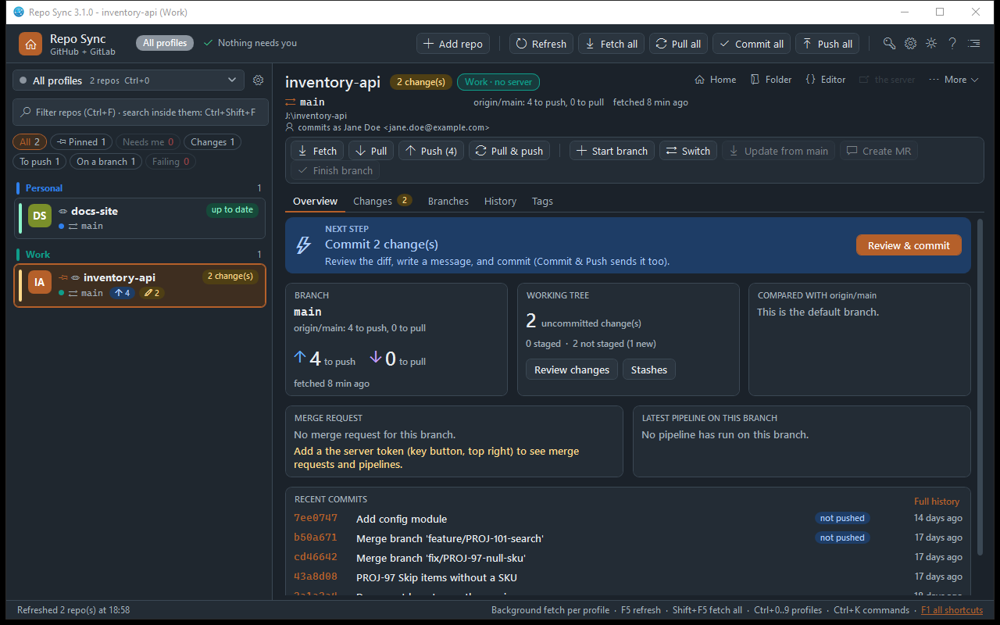
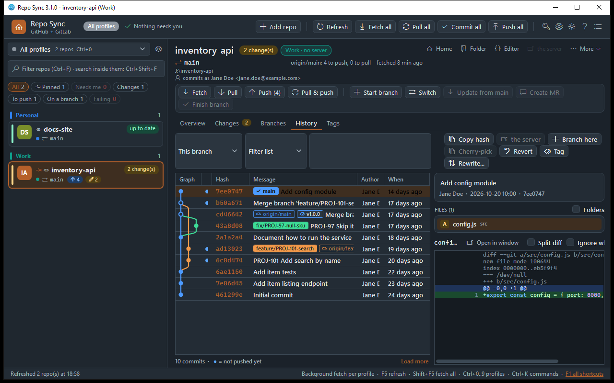
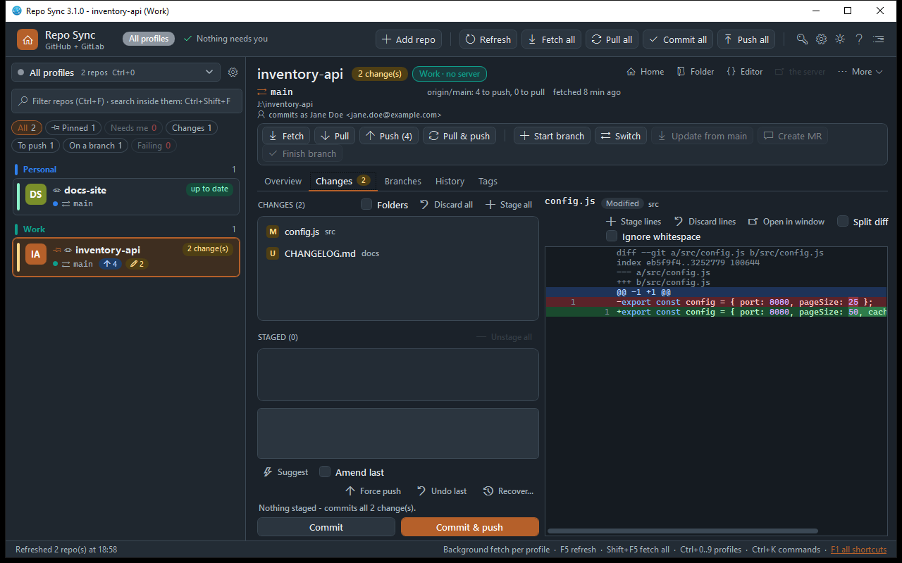
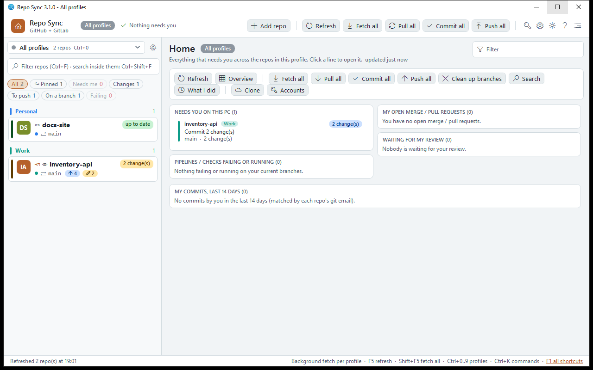

# Repo Sync

A Windows desktop client for everyday Git work across GitHub and GitLab: see every repo at a glance, commit, sync, branch, review merge / pull requests and watch pipelines without typing git commands.

[](https://github.com/lmohler/repo-sync-p/actions/workflows/build.yml)



| History with branch graph | Changes with line staging |
|---|---|
|  |  |



## Features

- **Multi-repo dashboard**: repo cards with status stripes, ahead/behind and change badges, filter chips, and a Home page that lists only what needs attention.
- **Next step guidance**: each repo shows a computed "what to do now" banner (commit, pull, push, open a merge request, fix a pipeline).
- **Commit workflow**: stage files, hunks or single lines; word-level, syntax-highlighted split or unified diffs; ticket key prefixed from the branch name.
- **History**: commit graph with branch / tag / remote labels, search by message, code (`-S`) or file, blame and file history.
- **Branches and rewriting**: start / switch / finish branches, interactive rebase (reorder, squash, reword, drop) with a preview, cherry-pick, revert, tags.
- **Safety net**: undo of the app's last action, reflog recovery, conflict resolver, large-file push guard, pre-push command per repo, guarded force push.
- **GitHub and GitLab**: merge / pull requests (create, review, comment, approve, merge), pipelines / Actions with job logs and first-error detection, artifact download.
- **Profiles with an identity guard**: e.g. *Personal* and *Work* profiles, each with its own commit identity; a commit or push with the wrong identity is blocked, warned or allowed (configurable).
- **Bulk actions**: fetch / pull / push / commit across many repos, global search (`git grep`) across all repos, "What I did" stand-up summary.
- **Also**: worktrees, stashes, remotes and submodules, repo health (`git gc`), an SVN round trip for repos that mirror SVN, migration export / import to a new PC, command palette (Ctrl+P), tray notifications, light and dark themes.

Every git command the app runs is shown in the Activity panel, and it uses your own `git.exe`, so hooks, credential manager and global config all apply. The full [user manual](docs/USER-MANUAL.md) walks through each feature.

## Tech stack

- C#, .NET 8, WPF (MVVM, no third-party UI libraries)
- GitHub REST API and GitLab REST API v4 clients written on `HttpClient`
- Tokens encrypted at rest with Windows DPAPI
- xUnit, ~235 tests that run against real throwaway git repositories (and a scratch SVN server when `svn` is installed)
- GitHub Actions for build, test and release

## Architecture

- `Services/` holds all git, SVN and server logic with no UI dependencies. `Git.cs` runs `git.exe` and parses porcelain output; `RepoActions.cs` implements every write operation; `IForge` (in `Forge.cs`) abstracts what the app needs from a server, with `GitHubClient` and `GitLabClient` mapping both providers onto shared models.
- `ViewModels/` follows MVVM. `MainViewModel` (repo list, profiles, bulk actions, background fetch) and `RepoDetailViewModel` (one repo's tabs) are split into partial files per area / tab.
- `Views/` has the main window, one UserControl per tab and the dialogs; `Themes/` has light / dark color dictionaries swapped at runtime.
- Interesting pieces: a lane-assigning commit graph renderer (`CommitGraph` + `GraphCell`), line / hunk staging by building partial patches for `git apply --recount` (`PartialPatch`), interactive rebase driven through `GIT_SEQUENCE_EDITOR` (`InteractiveRebase`), ref snapshots for undo (`UndoPoint`), a `.git` file watcher that debounces refreshes (`RepoWatcher`), and streaming `--progress` output with timeouts that reset on progress.
- Settings and tokens live next to the exe, so the app folder is portable.

Built with an architect-led, AI-assisted workflow (Claude Code): the author designed the features, reviewed and tested all changes.

## Build and run

Requirements: Windows 10/11, the [.NET 8 SDK](https://dotnet.microsoft.com/download/dotnet/8.0), and Git on `PATH`.

```powershell
git clone https://github.com/lmohler/repo-sync.git
cd repo-sync
dotnet build RepoSyncV3.slnx
dotnet run --project RepoSyncV3
```

Self-contained single-file exe (no .NET install needed to run it):

```powershell
dotnet publish RepoSyncV3/RepoSyncV3.csproj -c Release -r win-x64 --self-contained true `
  -p:PublishSingleFile=true -p:IncludeNativeLibrariesForSelfExtract=true -o publish
```

## Tests

```powershell
dotnet test RepoSyncV3.Tests
```

The tests create throwaway repositories under `%TEMP%` and delete them afterwards. They need `git` on `PATH` with a `user.name` / `user.email` configured; the SVN tests also use `svn` / `svnadmin` and are skipped without them.

## Download

Pre-built `repo-sync-v3.exe` (Windows x64, self-contained) is attached to each [GitHub Release](https://github.com/lmohler/repo-sync-p/releases). Every CI run also uploads the exe as a build artifact.

## License

[MIT](LICENSE) - Copyright (c) 2026 Lucas Mohler
